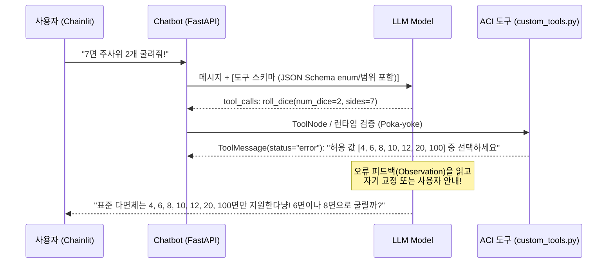

# 🎯 Mission 01: ACI 철학 기반의 좋은 도구 설계 및 Chatbot 바인딩 검증

에이전트는 LLM에 **도구(Tools)**라는 손발을 쥐어줄 때 비로소 외부 세계와 상호작용할 수 있습니다.  
하지만 단순히 파이썬 함수에 `@tool`만 붙인다고 좋은 도구가 되지는 않습니다. 모델이 **어떻게 도구 설명을 읽고, 실수를 예방하며, 실패 시 에러를 통해 스스로 고치고, 컨텍스트 창을 망가뜨리지 않는지**를 설계해야 합니다.

본 미션에서는 **ACI(Agent-Computer Interface)** 철학에 따라 좋은 도구의 4대 조건을 이해하고, 이를 적용한 커스텀 도구를 직접 구현해 `chatbot` 에이전트에 연결한 뒤 Chainlit UI에서 대화로 호출·검증합니다.

---

## 📂 실습 대상 파일 안내

| 파일 경로 | 역할 | 실습 내용 |
| :--- | :--- | :--- |
| `app/tools/common.py` | 프로덕션 ACI 레퍼런스 | 이미 `chatbot`에 탑재된 내장 도구(`file_read`)의 ACI 설계 패턴 확인 |
| `app/tools/custom_tools.py` | 커스텀 도구 정의 | 필수 도구 `roll_dice`를 ACI 원칙에 맞게 구현 + *(Optional)* 나만의 자유 도구 추가 |
| `app/agents/chatbot/agent.py` | 에이전트 팩토리 | `CUSTOM_TOOLS`를 임포트하고 `active_tools` 목록에 결합 |

---

## 💡 핵심 이론: ACI(Agent-Computer Interface)와 좋은 도구의 4대 요소

사람을 위해 UI/UX를 설계하는 것이 **HCI(Human-Computer Interface)**라면, LLM 모델이 컴퓨터와 상호작용하기 좋도록 도구 인터페이스를 설계하는 것이 **ACI(Agent-Computer Interface)**입니다.

좋은 도구는 아래 **4가지 요소**가 조화롭게 맞물려야 합니다.

| ACI 4대 요소 | 핵심 목적 | 구현 수단 (LangChain / Pydantic) |
| :--- | :--- | :--- |
| **1. 정답 반환 & 컨텍스트 제한** | 필요한 정보만 구조화해 전달하고, 대량 출력으로 컨텍스트 창이 오염되는 것을 방지 | 요약/페이지네이션/상한선 적용 (예: 대량 결과 시 목록 생략 후 통계 요약) |
| **2. 제약 사항과 안정성 (Poka-yoke)** | 모델이 엉뚱한 값이나 위험한 인자를 넘기는 실수를 스키마 단계에서 원천 차단 | `BaseModel` + `Field(ge/le)` · `Literal[...]`(`enum`) + 런타임 경계 검사 |
| **3. 예외 처리 & 오류 피드백** | 실행 실패 시 서버가 크래시되지 않고, 모델이 원인을 읽어 인자를 고칠 수 있는 피드백 반환 | 스키마 오류는 `ToolNode`가 자동 변환, 런타임 오류는 `ToolException` + `handle_tool_error = True` (`ToolMessage(status="error")`) |
| **4. 설명과 인자 정의의 조화** | 언제 호출해야 하고 **언제 호출하지 말아야 하는지(경계)**를 명확히 전달 | `args_schema` 분리(`Args:` 중복 방지) + `Usage:` / `When NOT to use:` |



### ❌ 나쁜 도구 vs ✅ ACI 좋은 도구 (`roll_dice` 비교)

| 항목 | ❌ 단순 함수형 초안 | ✅ ACI 설계 적용 (`roll_dice`) |
| :--- | :--- | :--- |
| **인자 제약** | `sides: int = 6` — `sides=0`이나 `-3` 입력 시 `random.randint`에서 **런타임 크래시** | `Field(ge=1, le=100)` · `Field(ge=4, le=100)` + 런타임 `_ALLOWED_SIDES` 검사(`ToolException`) |
| **경계값 처리** | `num_dice = min(num_dice, 10)` — 50개를 요청해도 아무 말 없이 10개만 굴림 (**침묵 보정**) | 100개 초과 시 명확한 오류 피드백 반환, 21~100개는 요약 모드임을 응답에 명시 |
| **컨텍스트 보호** | 500개를 굴리면 `[3, 1, 6, ...]` 숫자 500개를 그대로 뱉어 **토큰 낭비** | 20개 초과 시 개별 눈 나열을 생략하고 **합계·평균·최소·최대·분포 요약**만 반환 |
| **오류 계약** | `return "⚠️ 오류..."`처럼 일반 문자열 반환 → 로거/평가기가 실패 여부를 구분 못 함 | `ToolException` + `handle_tool_error = True`로 `ToolMessage(status="error")` 계약 준수 |
| **설명 경계** | *"난수 생성 시 반드시 호출"* → 로또(1~45)나 파이썬 시뮬레이션과 충돌 | `Usage:`와 `When NOT to use:`(임의 범위/100회 초과는 `bash_command` 사용) 분리 |

> [!TIP]
> **`args_schema`와 `ToolNode`의 기본 동작**:  
> `BaseModel`로 `args_schema`를 분리하면 파라미터의 타입, 기본값, 범위(`minimum`/`maximum`), 허용 목록(`enum`), 설명이 Tool Schema JSON에 구조화되어 들어가며, 모델이 스키마를 어겨도 LangGraph `ToolNode`가 Pydantic 검증 오류를 자동으로 `ToolMessage(status="error")`로 바꿔 모델에 돌려줍니다. 반면 함수 내부에서 발생시키는 `ToolException`은 **`<도구>.handle_tool_error = True`** 한 줄을 붙여야 서버 크래시 없이 에러 관찰 메시지로 전달됩니다.
>
> **💡 Gemini SDK 참고**: Gemini 함수 선언 스키마(`types.Schema`)는 `enum` 값으로 문자열만 허용하므로 `Literal["approve", "reject"]` 같은 **문자열 선택지**에 `Literal[...]`을 사용하고, `sides`처럼 **정수 이산 집합**은 `int = Field(ge=4, le=100)` + 함수 본문 `_ALLOWED_SIDES` 검사(`ToolException`)로 검증합니다.

---

## 🔍 워밍업 (2분): 프로덕션 ACI 레퍼런스 해부 (`app/tools/common.py`)

`chatbot`에는 이미 프로덕션 수준으로 설계된 범용 도구 9종([`app/tools/common.py`](../app/tools/common.py))이 탑재되어 있습니다. 코드를 구현하기 전에 `file_read` 주변부(469~580행)를 열어 다음 4가지가 어떻게 맞물려 있는지 눈으로 확인해 보세요:

1. `FileReadInput(BaseModel)` — `offset`, `limit`으로 한 번에 읽을 범위를 강제
2. `max_total_chars = 50000` — 대용량 파일이 컨텍스트 창을 덮지 않도록 절단 및 다음 `offset` 커서 안내
3. `ToolException` + `_suggest_similar_files` — 없는 파일 입력 시 오타와 비슷한 파일명을 힌트로 돌려주어 모델이 스스로 재시도
4. `handle_tool_error = True` — `ToolException`을 안전하게 `ToolMessage(status="error")`로 변환

이제 우리 커스텀 도구에도 **똑같은 ACI 설계 원칙**을 적용해 봅시다!

---

## 🛠️ 실습 단계별 수행 가이드

### 1단계 (필수): `app/tools/custom_tools.py`에 ACI 기반 `roll_dice` 구현하기

[`app/tools/custom_tools.py`](../app/tools/custom_tools.py) 파일을 열고, **필수 커스텀 도구 `roll_dice`**를 ACI 4대 원칙에 맞춰 구현한 뒤 `roll_dice.handle_tool_error = True` 설정과 `CUSTOM_TOOLS` 리스트 등록을 완료하세요.

> ⚠️ **주의**: 자동화 검증 스크립트(`test_mission01.py`)와 이후 미션(`Mission 03, 05, 07, 08`)에서 **`roll_dice`와 `CUSTOM_TOOLS`를 직접 참조하여 검증**하므로, `roll_dice`의 이름과 인자 스키마 규격은 반드시 유지해야 합니다.

```python
# app/tools/custom_tools.py (TODO ① 영역에 작성)
_ALLOWED_SIDES = (4, 6, 8, 10, 12, 20, 100)
_DETAILED_ROLL_LIMIT = 20


class RollDiceInput(BaseModel):
    num_dice: int = Field(
        default=1,
        ge=1,
        le=100,
        description=(
            "굴릴 주사위 개수 (1~100, 기본값: 1). "
            "20개를 초과하면 컨텍스트 보호를 위해 개별 눈 목록 대신 통계 요약만 반환합니다."
        ),
    )
    sides: int = Field(
        default=6,
        ge=4,
        le=100,
        description="주사위의 면 수 (표준 다면체: 4, 6, 8, 10, 12, 20, 100 중 선택, 기본값: 6).",
    )


@tool(args_schema=RollDiceInput)
def roll_dice(num_dice: int = 1, sides: int = 6) -> str:
    """표준 다면체 주사위를 굴려 무작위 결과와 통계를 반환합니다.

    Usage:
    - 사용자가 주사위 굴리기, 보드게임/TRPG 판정(d4~d100), 간단한 확률 추첨을 요청할 때 호출하세요.
    - 20개 이하는 개별 눈 목록과 통계를, 21~100개는 컨텍스트 창 보호를 위해 통계 요약만 반환합니다.
    - When NOT to use: 표준 다면체 외 임의 범위 난수(예: 1~45 로또), 암호학적 난수, 100회 초과 대규모 시뮬레이션은 bash_command(Python)를 사용하세요.
    """
    if num_dice < 1 or num_dice > 100:
        raise ToolException(
            "RollDice Error: 'num_dice'는 1~100 범위여야 합니다. "
            "100회를 초과하는 시뮬레이션은 bash_command(Python)를 사용하세요."
        )
    if sides not in _ALLOWED_SIDES:
        raise ToolException(
            f"RollDice Error: 지원하지 않는 면 수(sides={sides})입니다. "
            f"허용 값 {list(_ALLOWED_SIDES)} 중 하나를 선택해 다시 호출하세요."
        )

    rolls = [random.randint(1, sides) for _ in range(num_dice)]
    total = sum(rolls)
    avg = total / num_dice
    low = min(rolls)
    high = max(rolls)

    if num_dice <= _DETAILED_ROLL_LIMIT:
        return (
            f"🎲 주사위 {num_dice}개(d{sides}) 결과: {rolls} | "
            f"합계: {total} (평균: {avg:.2f}, 최소: {low}, 최대: {high})"
        )

    counts = Counter(rolls)
    if sides <= 20:
        dist_note = "눈 분포: " + ", ".join(f"{k}:{counts[k]}" for k in sorted(counts))
    else:
        top5 = ", ".join(f"{k}({c}회)" for k, c in counts.most_common(5))
        dist_note = f"고유 눈 {len(counts)}종, 최빈값 TOP 5: {top5}"

    return (
        f"🎲 주사위 {num_dice}개(d{sides}) 요약 결과 "
        f"(컨텍스트 보호: {_DETAILED_ROLL_LIMIT}개 초과로 개별 눈 목록 생략) | "
        f"합계: {total} (평균: {avg:.2f}, 최소: {low}, 최대: {high}) | {dist_note}"
    )


roll_dice.handle_tool_error = True
```

그리고 파일 하단의 `CUSTOM_TOOLS` 리스트에 `roll_dice`를 등록합니다:
```python
CUSTOM_TOOLS = [roll_dice]
```

---

### 2단계 (Optional / 선택): 스스로 만들고 싶은 나만의 도구 추가하기

> 💡 이 단계는 **선택 사항**입니다. `roll_dice`만 구현해도 미션 통과 및 이후 모든 미션 진행에는 전혀 문제가 없습니다.

`chatbot`에게 쥐어주고 싶은 나만의 도구가 있다면, `app/tools/custom_tools.py`에 자유롭게 추가해 보세요! 단, 좋은 도구의 4대 원칙을 직접 설계해 보는 것이 핵심입니다:

1. **설명 & 인자 정의**: `BaseModel` + `Field(description=...)`로 `args_schema`를 정의하고, Docstring에는 `Usage:`(사용 시점과 `When NOT to use:` 경계)를 명시하기 (`Args:` 섹션 중복 작성 금지)
2. **제약 사항**: `Literal[...]`(`enum`), `Field(ge=..., le=...)`, `min_length`/`max_length` 등으로 허용 입력 범위 고정하기
3. **컨텍스트 제한**: 출력이 길어질 수 있다면 최대 줄 수·글자 수 상한 또는 요약 규칙 적용하기
4. **오류 피드백 & 등록**: 예외 상황에서 복구 힌트가 담긴 `ToolException`을 발생시키고, `내_도구.handle_tool_error = True` 설정 후 `CUSTOM_TOOLS = [roll_dice, 내_도구]`에 추가하기

`test_mission01.py`는 `CUSTOM_TOOLS`에 추가된 자유 도구를 자동으로 감지해 ACI 계약(스키마·설명·에러 핸들링·에이전트 바인딩)을 함께 점검해 줍니다.

---

### 3단계: `app/agents/chatbot/agent.py`에 `CUSTOM_TOOLS` 바인딩하기

[`app/agents/chatbot/agent.py`](../app/agents/chatbot/agent.py) 파일을 열고, `CUSTOM_TOOLS`를 임포트하여 `active_tools` 리스트에 결합합니다. (`CUSTOM_TOOLS` 단위로 연결하면 2단계에서 나만의 도구를 추가하더라도 에이전트 코드를 다시 고칠 필요가 없습니다!)

```python
# app/agents/chatbot/agent.py
AGENT_METADATA = {
    "name": "chatbot",
    "description": "3대 코어(프롬프트, 도구, 단기메모리)와 ACI 커스텀 도구가 탑재된 고양이 챗봇",
    "roles": ["main"],  # main: UI 대화 전용 (서브에이전트 위임 대상 제외)
}

# ... (생략) ...

# 1단계에서 작성한 커스텀 도구 레지스트리 임포트
from app.tools.custom_tools import CUSTOM_TOOLS

# ... (생략) ...

async def create_agent_executor(checkpointer=None):
    # ... (생략) ...

    # ---------------------------------------------------------------------------
    # [Mission 01] 커스텀 도구 바인딩
    # ---------------------------------------------------------------------------
    active_tools = list(tools_chatbot) + list(CUSTOM_TOOLS)

    return create_agent(
        model=llm,
        tools=active_tools,              # 👈 등록된 도구 목록 전달
        system_prompt=CHATBOT_SYSTEM_PROMPT,
        checkpointer=checkpointer,
        context_schema=AgentContext
    )
```

---

### 4단계: ACI 자동화 검증 스크립트 실행 (`test_mission01.py`)

터미널에서 작성한 도구가 ACI 원칙(스키마 제약·컨텍스트 제한·오류 계약)과 챗봇 바인딩 조건을 충족하는지 검증합니다:

```bash
python tests/test_mission01.py
```

성공 시 아래와 같은 통과 메시지가 출력됩니다:
```text
✅ Test 1 통과: custom_tools.py 정의 및 CUSTOM_TOOLS 등록 확인
✅ Test 2 통과: roll_dice ACI 스키마(제약/설명/에러계약) 검증 완료
✅ Test 3 통과: roll_dice 정상 실행 · 컨텍스트 제한(50개 요약) · 오류 피드백(status='error') 검증 완료
ℹ️ Test 4 (선택): ... (자유 도구 추가 시 해당 도구의 ACI 계약 검증 결과 출력)
✅ Test 5 통과: chatbot 에이전트에 CUSTOM_TOOLS 바인딩 확인 (총 10종+)
🎉 [Mission 01] ACI 커스텀 도구 설계 및 챗봇 결합 검증 100% 통과!
```

---

### 5단계: Chainlit UI에서 대화로 도구 트리거링 & ACI 동작 관찰하기

1. 백엔드 서버를 재기동합니다 (UI 창은 그대로 두거나 필요 시 `chainlit run app/chainlit_ui.py --port 8080` 실행):
   ```bash
   python app/server.py --port 8000
   ```
2. 웹 브라우저(`http://localhost:8080`)에서 **`chatbot`** 프로필을 선택하고 아래 시나리오를 차례로 테스트해 보세요.

#### 🧪 테스트 1: 정상 호출 & 구조화된 정답 반환
* **사용자 입력**: `심심한데 주사위 2개 굴려줘!`
* **관찰 포인트**:
  - Chainlit UI에 **`roll_dice`** 도구 실행 스텝(Step)이 나타나는지 확인합니다.
  - 개별 결과 리스트와 함께 합계·평균·최소·최대 통계가 반환되고, LLM이 이를 바탕으로 답변하는지 확인합니다.

#### 🧪 테스트 2: 컨텍스트 제한 (Context Budget) 체감
* **사용자 입력**: `6면 주사위 50개 굴려서 결과 요약해줘!`
* **관찰 포인트**:
  - 50개의 숫자를 전부 나열하는 대신 `컨텍스트 보호: 20개 초과로 개별 눈 목록 생략` 메시지와 함께 합계·평균·눈 분포 요약만 반환되는지 확인합니다.

#### 🧪 테스트 3: 제약 조건(Poka-yoke)과 오류 피드백 관찰
* **사용자 입력**: `7면 주사위 2개 굴려줘!` 또는 `주사위 200개 굴려줘!`
* **관찰 포인트**:
  - 도구 스키마의 `enum`/`maximum` 제약 또는 런타임 검증이 작동해 서버 크래시 없이 에러 피드백이 반환되는지 확인합니다.
  - 모델이 피드백을 읽고 허용 가능한 면 수(`4, 6, 8, 10, 12, 20, 100`)나 개수(`1~100`)로 되묻거나 수정해 대안을 제시하는지 관찰합니다.

#### 🧪 테스트 4 *(Optional — 나만의 도구를 추가한 경우)*: 자유 도구 트리거링 검증
* **사용자 입력**: 자신이 만든 도구의 `Usage:` 설명에 맞는 자연어 질문을 던져 보세요!
* **관찰 포인트**:
  - 모델이 Docstring과 스키마를 보고 내 도구를 스스로 선택해 정확한 인자로 호출하는지 확인합니다.
  - 일부러 경계값을 벗어난 요청도 던져서, 내가 설계한 오류 피드백과 컨텍스트 제한이 의도대로 작동하는지 직접 체감해 보세요.

---

## 💡 트러블슈팅: LLM이 도구를 안 부르고 말로만 답할 때

1. **Docstring의 `Usage:`에 명확한 호출 시점과 경계가 있는가?**:
   - 나쁜 예: `"""주사위를 굴립니다."""`
   - 좋은 예: `"""... Usage: 사용자가 주사위, 보드게임/TRPG 판정을 요청할 때 호출하세요. ..."""`
2. **함수를 `CUSTOM_TOOLS` 리스트에 넣었는가?**:
   - `CUSTOM_TOOLS` 리스트가 비어 있거나, `app/agents/chatbot/agent.py`의 `active_tools`에 `+ list(CUSTOM_TOOLS)`가 빠져 있으면 모델에게 도구 스키마가 전달되지 않습니다.
3. **도구 실행 중 `ToolException`이 났는데 챗봇 전체가 멈춘다면?**:
   - `<도구>.handle_tool_error = True` 한 줄이 빠져 있거나, 잘못된 입력 시 `ToolException` 대신 일반 `ValueError`를 그대로 `raise`했을 가능성이 큽니다. `handle_tool_error = True`는 `ToolException`만 가로채서 `ToolMessage(status="error")`로 바꿔줍니다.

---

## 🏆 Mission 01 완료 체크리스트

- [ ] `app/tools/common.py`의 `file_read`에서 프로덕션 ACI 도구 구조를 확인했다.
- [ ] `app/tools/custom_tools.py`에 ACI 4대 원칙이 적용된 `roll_dice`를 구현(`handle_tool_error = True` 포함)하고 `CUSTOM_TOOLS`에 등록했다.
- [ ] *(Optional)* 스스로 만들고 싶은 나만의 커스텀 도구를 구현해 `CUSTOM_TOOLS`에 추가했다.
- [ ] `app/agents/chatbot/agent.py`의 `active_tools`에 `CUSTOM_TOOLS`를 바인딩했다.
- [ ] `python tests/test_mission01.py`를 실행하여 모든 검증을 통과했다.
- [ ] Chainlit UI에서 대화로 도구를 트리거링하고 컨텍스트 제한 및 오류 피드백 동작을 확인했다.
