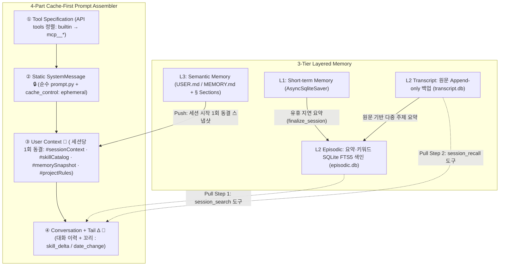

# 🎯 Mission 03. 캐시 우선 4단 프롬프트 조립기 & 계층형 메모리 하네스 (Prompt Assembler & Layered Memory)

> **🎯 목표**: 정적(Static) 단일 문자열 프롬프트의 한계를 극복하고, Claude Code 패턴을 단순화한 **캐시 우선(Cache-First) 4단 Prompt Assembler**와 **계층형 메모리(L3 Semantic Push + L2 Episodic 2-Stage Pull)**를 결합하여 `main_agent`를 고성능 프로덕션 오케스트레이터로 진화시킵니다.
> 
> *(※ 본 미션에서는 `app/agents/main_agent/agent.py`에 별도의 TODO 주석을 달아두지 않았으므로, 본 가이드의 안내에 따라 필요한 모듈과 코드를 직접 추가해 나갑니다.)*

---

## 📂 실습 대상 파일 안내

| 파일 경로 | 역할 | 실습 내용 |
| :--- | :--- | :--- |
| `app/agents/main_agent/agent.py` | 메인 에이전트 | 캐시 우선 4단 프롬프트 조립기 및 L2/L3 계층형 메모리 결합 (수정 대상) |
| `app/middleware/prompt/` | 프롬프트 미들웨어 | `PromptAssembler`, `SkillPromptBuilder`, `create_prompt_assembler_middleware` |
| `app/middleware/memory/` | 메모리 미들웨어 | `SemanticMemoryStore`, `TranscriptStore`, `EpisodicStore`, `MemoryMiddleware` |
| `tests/test_mission03.py` | 자동화 검증 & 시각화 | 스토어 동작·프리픽스 불변 검증 및 **`show_prompt_map` 4단 실물 시각화** |

---

## 💡 핵심 이론: 프롬프트 캐싱(Cache-First)과 Push/Pull 계층형 메모리



### 1. Claude Code 캐시 우선(Cache-First) 4단 Prompt Assembler
현대 프로덕션 에이전트는 토큰 비용 절감과 지연 시간 단축을 위해 **변하지 않는 앞단 프리픽스를 100% 바이트 동일하게 유지**하는 4단 구조를 사용합니다:

* **① Tool Specification (`API tools` 필드)**:
  * `create_agent(..., tools=...)`에 바인딩된 도구 스키마를 `SystemMessage` 본문에 중복 덤프하지 않고, 호출 직전 `sort_tools_for_cache()`로 **내장 도구 이름순 → MCP 도구(`mcp__*`) 이름순** 정렬하여 캐시 prefix를 안정화합니다.
* **② Static `SystemMessage` 🔒 (`cache_control: ephemeral`)**:
  * `prompt.py`의 순수 역할 지침(`SUPERVISOR_SYSTEM_PROMPT`)만 담습니다. 날짜·세션 ID·메모리·스킬 실행 지침(`SKILL.md`)·스킬 목록을 **1바이트도 섞지 않아** 모든 사용자와 세션이 공유하는 전역 캐시 줄기가 됩니다.
* **③ Session-Frozen `User Context` 📌 (`[01] Human<user_context>`)**:
  * 대화 맨 앞 `<system-reminder>` `HumanMessage`에 세션 시작 시 1회 동결하여 삽입합니다(`# sessionContext`, `# skillCatalog`[실행 지침 + 초기 목록], `# memorySnapshot`, `# projectRules`). 세션 도중 날짜가 바뀌거나 스킬이 추가·제거돼도 이 앞단 블록을 수정하지 않습니다.
* **④ `Conversation + Tail <system-reminder>` 🍃**:
  * 자정 날짜 변경(`date_change`)과 세션 중 스킬 변화(`skill_delta`)는 앞단 `[00]~[02]` 프리픽스를 건드리지 않고 **대화 맨 끝에만 Append-only `<system-reminder>`로 덧붙여** 프리픽스 캐시를 100% 보존합니다.

---

### 2. 3-Tier Layered Memory 구조 (Push vs Pull 분리)
에이전트는 기억의 성격에 따라 **세션 시작 시 1회 동결 주입(Push)**과 **필요할 때 도구로 조회(Pull)**를 명확히 분리합니다:

| 계층 | 기억 종류 | 저장 매체 | 수명 / 접근 방식 | 주요 역할 |
| :--- | :--- | :--- | :--- | :--- |
| **L1** | 단기 기억 (Working) | `AsyncSqliteSaver` (Checkpointer) | 현재 세션/대화 스레드 | 모델 입력용 컨텍스트 유지 (`SummarizationMiddleware`가 `before_model`에서 이전 대화를 요약본으로 교체) |
| **L2 (원문)** | 에피소드 원문 (Transcript) | `TranscriptStore` (`transcript.db`) | 영구 보관 (Append-only / **Pull**) | 사용자 질문·AI 응답·도구 호출(`tool_calls`)·도구 결과를 무손실 백업 (`session_recall` 조회 대상) |
| **L2 (색인)** | 에피소드 색인 (Episodic Index) | `EpisodicStore` (`episodic.db` FTS5) | 영구 보관 (세션 간 / **Pull**) | 다중 주제 요약·키워드·사용 도구 FTS5 색인 (`session_search` 검색 대상) |
| **L3** | 시맨틱 기억 (Semantic) | `USER.md` / `MEMORY.md` (`§` 분리) | 영구 보관 (파일 기반 / **Push+Tool**) | `before_agent`에서 세션 시작 스냅샷을 **③ User Context `# memorySnapshot`에 동결 주입**, 갱신은 `memory` 도구 |

---

### 3. 세션 데이터 이원화 · 유휴 지연 인덱싱(`IdleReviewQueue`) · 2-Stage Pull 회상
과거 대화 전체를 프롬프트에 매 턴 넣으면 토큰이 폭발하고 KV-Cache가 매 턴 깨집니다. 따라서 **에피소드 기억은 프롬프트에 자동 주입하지 않고**, 에이전트가 필요할 때 직접 검색·회상하는 **2단계 Pull 도구(`session_search` → `session_recall`)** 패턴을 적용합니다:

1. **실시간 원문 백업 (`TranscriptStore` — `transcript.db`)**:
   - `MemoryMiddleware`가 `before_agent`(사용자 질문), `wrap_model_call`(AI 응답 및 도구 호출 인자), `wrap_tool_call`(도구 실행 결과) 시점마다 `transcript.db`에 멱등(Append-only) 기록합니다.
   - `SummarizationMiddleware`가 `before_model`에서 모델 컨텍스트(`state["messages"]`)를 요약본으로 교체하더라도 `transcript.db`의 원문과 도구 기록은 100% 보존됩니다.
2. **유휴 지연 요약 인덱싱 (`IdleReviewQueue` + `finalize_session`)**:
   - 매 턴 종료 즉시 무거운 LLM 요약을 실행하는 대신, `IdleReviewQueue`에 예약하여 **마지막 턴 종료 후 15초 동안 추가 입력이 없거나(유휴), 연속 대화 시 최초 예약 후 30분이 경과했을 때** 백그라운드 스레드에서 실행합니다 (사용자 복귀 시 대기 중인 리뷰는 즉시 취소).
   - `transcript.db`의 전체 원문을 읽어 [1단계: 로컬 단어 추출] + [2단계: LLM 다중 주제(Topics) 요약 및 한/영 키워드 추출]을 거쳐 `episodic.db`(FTS5)에 색인합니다.
3. **1단계 탐색 (`session_search` Pull 도구)**:
   - 과거 대화 맥락이 필요할 때 에이전트가 자율적으로 `session_search(query=..., top_k=...)`를 호출하여 `episodic.db` FTS5에서 후보 세션과 주제 요약·`anchor_message`를 탐색합니다 (검색 결과는 일반 `ToolMessage`로 대화 흐름에만 남으므로 앞단 캐시가 전혀 깨지지 않습니다).
4. **2단계 원문 회상 (`session_recall` Pull 도구)**:
   - 탐색된 세션 중 구체적 대화가 필요한 항목에 대해 `session_recall(session_id, anchor_message)`를 호출하여 `transcript.db`에서 해당 지점의 실제 대화·도구 원문 슬라이스를 정밀 복원합니다.

---

## 🛠️ 실습: `app/agents/main_agent/agent.py` 수정 가이드

`app/agents/main_agent/agent.py` 파일에 아래 단계별 코드를 순서대로 추가/수정합니다.

### 1단계: 커스텀 도구 및 메모리/프롬프트 미들웨어 임포트 추가
파일 상단에 Mission 01에서 만든 커스텀 도구(`CUSTOM_TOOLS`)와 `SemanticMemoryStore`, `TranscriptStore`, `EpisodicStore`, `MemoryMiddleware`, `PromptAssembler`, `SkillPromptBuilder`, `create_prompt_assembler_middleware`를 임포트합니다:

```python
# 기존 임포트 아래에 추가
from app.tools.custom_tools import CUSTOM_TOOLS
from app.middleware.memory import (
    SemanticMemoryStore,
    TranscriptStore,
    EpisodicStore,
    MemoryMiddleware,
)
from app.middleware.prompt import (
    PromptAssembler,
    SkillPromptBuilder,
    create_prompt_assembler_middleware,
)
```

---

### 2단계: L3 Semantic Store & L2 Transcript/Episodic Store 초기화

#### ① 메모리 설정 파일 확인 — `configs/memory.config` (수정 불필요)

> [!IMPORTANT]
> 아래 JSON은 **`agent.py`에 붙여 넣는 코드가 아닙니다!**
> 프로젝트 루트의 설정 파일 [`configs/memory.config`](../configs/memory.config)에 **이미 들어 있는 내용**이며, 에이전트 코드는 이 파일을 읽어서(`_load_config`) 사용합니다.
> 기본값 그대로 실습하면 되므로 **이 파일은 열어서 내용만 확인**하세요.

📄 **파일 위치: `configs/memory.config`** (JSON 설정 파일)
```json
{
  "semantic_memory": { "enabled": true, "memory_dir": "./artifacts/users/default/memory", "auto_review": true },
  "episodic_memory": { "enabled": true, "db_path": "./app/database/episodic.db", "top_k_prefetch": 2, "auto_finalize": true, "finalize_idle_settle_s": 15, "finalize_max_age_s": 1800 },
  "transcript": { "enabled": true, "db_path": "./app/database/transcript.db", "recall_max_chars": 2000 }
}
```

| 키 | 의미 |
| :--- | :--- |
| `transcript.enabled` / `db_path` | 대화 원문(질문·답변·도구 호출·결과) 실시간 Append-only 백업 DB (`episodic_memory` 스위치와 독립 동작) |
| `semantic_memory.memory_dir` | `USER.md` / `MEMORY.md` 위치. 기본값이면 사용자별로 `artifacts/users/{user_id}/memory/`에 자동 격리 (다른 경로 지정 시 `{memory_dir}/users/{user_id}/memory/`) |
| `episodic_memory.db_path` | 과거 세션 다중 주제 요약 + FTS5 인덱스 DB (`user_id` 컬럼으로 사용자 격리) |
| `episodic_memory.top_k_prefetch` | `session_search` 도구의 기본 반환 개수 `top_k` (기본값 `2`) |
| `finalize_idle_settle_s` / `finalize_max_age_s` | 유휴 지연 요약 대기 시간(기본 15초) 및 연속 대화 시 최대 요약 보류 시간(기본 1800초=30분) |
| `enabled` / `auto_review` / `auto_finalize` | 인출·학습 ON/OFF — 서버가 요청마다 `AgentContext` 플래그로 전달 |

#### ② `agent.py`에 스토어 초기화 코드 추가

이제 `app/agents/main_agent/agent.py`를 열고, `create_agent_executor()` 내부의 **`# 4. 도구 바인딩` 블록과 `# 5. 미들웨어 파이프라인` 블록 사이**에 위 설정 파일을 읽어 L3 및 L2 스토어를 초기화하는 코드를 추가합니다.
> 💡 2~4단계에서 작성하는 블록(`# 4-1` ~ `# 4-5`)은 모두 이 위치(`# 4`와 `# 5` 사이)에 순서대로 추가합니다.

📄 **파일 위치: `app/agents/main_agent/agent.py`** (Python 코드)
```python
    # 4-1. 메모리 설정 로드 (configs/memory.config)
    memory_cfg = _load_config("./configs/memory.config", {})
    sem_cfg = memory_cfg.get("semantic_memory", {})
    epi_cfg = memory_cfg.get("episodic_memory", {})
    tr_cfg = memory_cfg.get("transcript", {})

    # 4-2. L3 Semantic Memory Store 초기화 (USER.md, MEMORY.md)
    memory_dir = sem_cfg.get("memory_dir", "./artifacts/users/default/memory")
    os.makedirs(memory_dir, exist_ok=True)
    semantic_store = SemanticMemoryStore(
        memory_dir=memory_dir,
        memory_char_limit=4000,
        user_char_limit=2000,
    )
    semantic_store.load_from_disk()

    # 4-3. L2 원문 저장소(TranscriptStore) + 요약 색인(EpisodicStore) 초기화
    transcript_db_path = tr_cfg.get("db_path", "./app/database/transcript.db")
    os.makedirs(os.path.dirname(transcript_db_path) or ".", exist_ok=True)
    transcript_store = TranscriptStore(
        db_path=transcript_db_path,
        recall_max_chars=int(tr_cfg.get("recall_max_chars", 2000)),
    )
    await transcript_store.setup()

    episodic_db_path = epi_cfg.get("db_path", "./app/database/episodic.db")
    os.makedirs(os.path.dirname(episodic_db_path) or ".", exist_ok=True)
    episodic_store = EpisodicStore(
        db_path=episodic_db_path,
        transcript_store=transcript_store,
    )
    await episodic_store.setup()
```

---

### 3단계: MemoryMiddleware 구성 및 도구 바인딩
스토어와 훅, 그리고 자율 메모리 도구 3종(`memory`, `session_search`, `session_recall`)을 소유한 `MemoryMiddleware`를 생성하고, 활성 도구 목록(`active_tools`)에 Mission 01 커스텀 도구(`CUSTOM_TOOLS`)를 결합합니다:

> 💡 **미들웨어 도구 자동 등록 (`AgentMiddleware.tools`)**:  
> `MemoryMiddleware`는 내부에 `self.tools = [memory, session_search, session_recall]`을 보유하고 있습니다. 따라서 `active_tools`에 메모리 도구를 수동으로 추가하지 않아도, `create_agent(..., middleware=[memory_mw, ...])` 호출 시 LangChain이 미들웨어의 `.tools`를 자동으로 수집하여 에이전트 도구 노드(`ToolNode`) 및 API `tools` 필드(`sort_tools_for_cache`)에 통합 등록합니다!

```python
    # 4-4. MemoryMiddleware 구성 (스토어 + memory / session_search / session_recall 도구 자동 등록 + 원문 기록 + 유휴 요약 훅)
    memory_mw = MemoryMiddleware(
        semantic_store=semantic_store,
        episodic_store=episodic_store,
        review_llm=llm,
        top_k=epi_cfg.get("top_k_prefetch", 2),
        transcript_store=transcript_store,
        transcript_enabled=tr_cfg.get("enabled", True),
        finalize_idle_settle_s=float(epi_cfg.get("finalize_idle_settle_s", 15.0)),
        finalize_max_age_s=float(epi_cfg.get("finalize_max_age_s", 1800.0)),
    )
```

그리고 Mission 02에서 작성한 **기존 `# 4. 도구 바인딩` 줄을 아래와 같이 수정**합니다. (`active_tools`를 새로 한 번 더 선언하지 말고, 기존 줄에 커스텀 도구만 추가합니다.)

```python
    # 4. 도구 바인딩 (Supervisor 17종 + Custom 도구 / Memory 3종 도구는 memory_mw가 create_agent에 자동 등록)
    active_tools = list(tools_supervisor) + list(CUSTOM_TOOLS)
```

---

### 4단계: 캐시 우선 4단 Prompt Assembler 조립
스킬 카탈로그 빌더와 단순화된 4단 프롬프트 조립기를 구성하고, LangChain AgentMiddleware로 래핑합니다.
- `system_prompt`: 순수 `SUPERVISOR_SYSTEM_PROMPT`만 전달합니다 (`SystemMessage`에 `cache_control: ephemeral` 적용).
- `skill_guidelines` + `skill_provider`: 정적 `SystemMessage`가 아니라 세션 시작 시 **③ `User Context` (`# skillCatalog`)**에 1회 동결 주입되며, 세션 도중 스킬 변동은 대화 꼬리 `skill_delta`로 전달됩니다.

```python
    # 4-5. Prompt Assembler 구성 (순수 정적 SystemMessage + 세션 동결 User Context + 스킬 Delta)
    #    - 스킬: 에이전트 내장 skills/ 폴더만 스캔 (SKILLS_DIR = app/agents/main_agent/skills)
    #    - skills/SKILL.md(스킬 실행 지침)와 초기 스킬 목록은 User Context(# skillCatalog)에 통합, 변경분은 Delta로 주입
    skill_guidelines = str(SKILLS_DIR / "SKILL.md") if (SKILLS_DIR / "SKILL.md").exists() else None
    skill_builder = SkillPromptBuilder(
        skills_dirs=[str(SKILLS_DIR)],
        guidelines_path=skill_guidelines,
    )

    assembler = PromptAssembler(
        system_prompt=SUPERVISOR_SYSTEM_PROMPT,
        skill_guidelines=skill_builder.load_guidelines,
        skill_provider=skill_builder.list_skills,
    )
    prompt_mw = create_prompt_assembler_middleware(assembler)
```

---

### 5단계: 미들웨어 파이프라인 결합 (CRITICAL 순서)
> ⚠️ **순서 주의**: `memory_mw`가 `prompt_mw`보다 바깥(앞)에 위치해야 꺼진 메모리 도구(`memory`, `session_search`, `session_recall`)가 먼저 필터링되어 `PromptAssemblerMiddleware`의 `sort_tools_for_cache()` 결과에 반영됩니다. (Semantic 스냅샷은 `before_agent`에서 `ctx.memory_snapshot`에 저장되어 `User Context`에 1회 동결됩니다.)
> `middleware = []` 바로 아래(Mission 02에서 작성한 `# (5) Self-Recovery` 위쪽)에 아래 **`(3) Memory & Prompt`** 블록을 추가합니다:
```python
    # 5. 미들웨어 파이프라인 (보안 & 거버넌스 순서)
    middleware = []

    # (3) Memory & Prompt — 메모리 도구 필터링 → 4단 프롬프트 조립 & Delta 주입
    middleware.extend([memory_mw, prompt_mw])

    # (5) Self-Recovery Circuit Breakers — 모델/도구 장애 자동 복구
    backup_model = os.getenv("FALLBACK_MODEL_NAME", "gpt-6.1-sol")
    middleware.extend([
        ModelFallbackMiddleware(
            max_retries=2,
            initial_delay=0.5,
            fallback_model_name=backup_model
        ),
        ToolErrorHandlerMiddleware(max_retries=0),
        ModelCallLimitMiddleware(run_limit=50, exit_behavior="end"),
    ])
```

---

### 6단계: create_agent 수정
`PromptAssemblerMiddleware`가 런타임에 4단 구조(정적 `SystemMessage` + `User Context` + Delta)를 조립해 주입하므로 `create_agent` 호출에서 고정 `system_prompt` 인자를 제거합니다:

```python
    # 6. 하네스로 결합된 최종 메인 에이전트 인스턴스 구축
    return create_agent(
        model=llm,
        tools=active_tools,
        middleware=middleware,
        checkpointer=checkpointer,
        context_schema=AgentContext,
    )
```

---

## 📋 완성된 `app/agents/main_agent/agent.py` 전체 코드 (Mission 03 시점 참고용)

<details>
<summary><b>👉 완성본 코드 펼치기/접기</b></summary>

```python
import os
import json
from pathlib import Path
from langchain.agents import create_agent

from app.utils import init_chat_model
from app.utils.database import get_shared_checkpointer
from app.context import AgentContext
from .prompt import SUPERVISOR_SYSTEM_PROMPT
from .tools import tools_supervisor
from app.tools.custom_tools import CUSTOM_TOOLS
from app.middleware.memory import (
    SemanticMemoryStore,
    TranscriptStore,
    EpisodicStore,
    MemoryMiddleware,
)
from app.middleware.prompt import PromptAssembler, SkillPromptBuilder, create_prompt_assembler_middleware
from app.middleware.error_control.self_recovery import (
    ModelFallbackMiddleware,
    ToolErrorHandlerMiddleware,
    ModelCallLimitMiddleware,
)

# 에이전트 내장 스킬 폴더 (app/agents/main_agent/skills/)
SKILLS_DIR = Path(__file__).resolve().parent / "skills"

AGENT_METADATA = {
    "name": "main_agent",
    "description": "하네스 기능을 연결할 메인 오케스트레이터 에이전트",
    "roles": ["main"],  # main: UI 대화 전용 (서브에이전트 위임 대상 제외)
}


def _load_config(path: str, default: dict) -> dict:
    try:
        if os.path.exists(path):
            with open(path, "r", encoding="utf-8") as f:
                return json.load(f)
    except Exception:
        pass
    return default


async def create_agent_executor(checkpointer=None):
    model_cfg = _load_config("./configs/model.config", {
        "model_name": "gemini-3.8-flash",
        "temperature": 0.0,
    })
    llm = init_chat_model(
        model=model_cfg.get("model_name", "gemini-3.8-flash"),
        temperature=model_cfg.get("temperature", 0.0)
    )

    if checkpointer is None:
        checkpointer = await get_shared_checkpointer()

    # 4. 도구 바인딩
    active_tools = list(tools_supervisor) + list(CUSTOM_TOOLS)

    # 4-1. 메모리 설정 로드
    memory_cfg = _load_config("./configs/memory.config", {})
    sem_cfg = memory_cfg.get("semantic_memory", {})
    epi_cfg = memory_cfg.get("episodic_memory", {})
    tr_cfg = memory_cfg.get("transcript", {})

    # 4-2. L3 Semantic Memory Store
    memory_dir = sem_cfg.get("memory_dir", "./artifacts/users/default/memory")
    os.makedirs(memory_dir, exist_ok=True)
    semantic_store = SemanticMemoryStore(
        memory_dir=memory_dir,
        memory_char_limit=4000,
        user_char_limit=2000,
    )
    semantic_store.load_from_disk()

    # 4-3. L2 TranscriptStore + EpisodicStore
    transcript_db_path = tr_cfg.get("db_path", "./app/database/transcript.db")
    os.makedirs(os.path.dirname(transcript_db_path) or ".", exist_ok=True)
    transcript_store = TranscriptStore(
        db_path=transcript_db_path,
        recall_max_chars=int(tr_cfg.get("recall_max_chars", 2000)),
    )
    await transcript_store.setup()

    episodic_db_path = epi_cfg.get("db_path", "./app/database/episodic.db")
    os.makedirs(os.path.dirname(episodic_db_path) or ".", exist_ok=True)
    episodic_store = EpisodicStore(
        db_path=episodic_db_path,
        transcript_store=transcript_store,
    )
    await episodic_store.setup()

    # 4-4. MemoryMiddleware
    memory_mw = MemoryMiddleware(
        semantic_store=semantic_store,
        episodic_store=episodic_store,
        review_llm=llm,
        top_k=epi_cfg.get("top_k_prefetch", 2),
        transcript_store=transcript_store,
        transcript_enabled=tr_cfg.get("enabled", True),
        finalize_idle_settle_s=float(epi_cfg.get("finalize_idle_settle_s", 15.0)),
        finalize_max_age_s=float(epi_cfg.get("finalize_max_age_s", 1800.0)),
    )

    # 4-5. 캐시 우선 4단 Prompt Assembler
    skill_guidelines = str(SKILLS_DIR / "SKILL.md") if (SKILLS_DIR / "SKILL.md").exists() else None
    skill_builder = SkillPromptBuilder(
        skills_dirs=[str(SKILLS_DIR)],
        guidelines_path=skill_guidelines,
    )

    assembler = PromptAssembler(
        system_prompt=SUPERVISOR_SYSTEM_PROMPT,
        skill_guidelines=skill_builder.load_guidelines,
        skill_provider=skill_builder.list_skills,
    )
    prompt_mw = create_prompt_assembler_middleware(assembler)

    # 5. 미들웨어 파이프라인 (보안 & 거버넌스 순서)
    middleware = []

    # (3) Memory & Prompt — 메모리 도구 필터링 → 4단 프롬프트 조립 & Delta 주입
    middleware.extend([memory_mw, prompt_mw])

    # (5) Self-Recovery Circuit Breakers — 모델/도구 장애 자동 복구
    backup_model = os.getenv("FALLBACK_MODEL_NAME", "gpt-6.1-sol")
    middleware.extend([
        ModelFallbackMiddleware(
            max_retries=2,
            initial_delay=0.5,
            fallback_model_name=backup_model
        ),
        ToolErrorHandlerMiddleware(max_retries=0),
        ModelCallLimitMiddleware(run_limit=50, exit_behavior="end"),
    ])

    # 6. 하네스로 결합된 최종 메인 에이전트 인스턴스 구축
    return create_agent(
        model=llm,
        tools=active_tools,
        middleware=middleware,
        checkpointer=checkpointer,
        context_schema=AgentContext,
    )
```
</details>

---

## 🧪 자동화 검증 & 프롬프트 시각화 실행

Codespaces 터미널에서 다음 검증 스크립트를 실행합니다:
```bash
python tests/test_mission03.py
```

### 🎨 시각화 출력 화면:
```text
================================================================================
🧪 [Mission 03] Simplified Prompt Assembler & Layered Memory 통합 검증 시작
================================================================================
  ✅ Test 1 통과: Semantic Memory Store 로드 성공 (USER 엔트리: ..., MEMORY 엔트리: ...)
  ✅ Test 2 통과: Episodic Store FTS5 인덱싱 및 검색 확인 (검색 적중 세션: session_test_arch_...)
  ✅ Test 3 통과: main_agent 메모리(3종)·커스텀 도구 바인딩 확인 (총 21종 도구)
  ✅ Test 4 통과: 정적 SystemMessage 순수성(가변 정보 0%) 및 PromptAssemblerMiddleware 탑재 확인

🎨 [실물 시각화 1] Turn 1 조립 결과 (Tools + Static System + Frozen User Context)
  🧰 tools (...개, builtin → mcp__*): [..., memory, session_recall, session_search, ...]
  [00] System     [정적 🔒 +cache]  당신은 사용자의 모든 요청을 ...
  [01] Human      <user_context>   # sessionContext · # skillCatalog · # memorySnapshot · # projectRules
  [02] Human                       ... (첫 질문)

🎨 [실물 시각화 2] Turn 2 조립 결과 (앞 [00]~[02] 프리픽스 100% 캐시 유지)
  ... ([00]~[02] 바이트 일치 + AI tool_call(session_search) + ToolMessage 뒤 append) ...
  ✅ Test 5 통과: User Context 동결 · session_search 도구 루프 · Turn 1→2 프리픽스 100% 바이트 일치 확인

🎉 [Mission 03] 모든 하네스(프롬프트 조립 + 계층형 메모리) 검증 100% 통과!
```

---

## 💬 Chainlit UI 대화 시나리오 테스트

FastAPI 서버(`http://localhost:8000`)와 Chainlit(`http://localhost:8080`)을 띄우고 `main_agent`를 선택한 뒤 아래 시나리오를 테스트합니다.

### 🎭 시나리오 1. Semantic Memory 자율 기록 및 개인화 QA
1. **사용자 입력**:
   ```text
   내 직업은 5년차 AI 소프트웨어 엔지니어이고, 주로 Python과 LangGraph를 다뤄. 이 사실을 기억해줘.
   ```
2. **동작 확인**:
   - 에이전트가 `memory(action="add", target="user", content="Identity: 5-year AI Software Engineer specializing in Python and LangGraph")` 도구를 호출하는지 확인.
   - `artifacts/users/user/memory/USER.md` 파일(Chainlit `user` 계정 로그인 기준, 또는 `artifacts/users/{user_id}/memory/USER.md`)에 해당 내용이 `§` 구분자로 즉시 추가되었는지 확인.
3. **후속 질문**:
   ```text
   내가 주로 어떤 언어와 프레임워크를 다룬다고 했지?
   ```
   - 에이전트가 `# memorySnapshot`에 동결 주입된 프로필을 바탕으로 정확하게 답변하는지 확인.

---

### 🎭 시나리오 2. 과거 세션 회상 (Episodic Memory & 2-Stage Pull Recall)

이 시나리오는 서로 다른 대화 세션 간에 에이전트가 프롬프트 자동 주입 없이도 **2단계 Pull 도구(`session_search` → `session_recall`)를 스스로 호출해 과거 대화를 환각 없이 복원하는지**를 검증합니다.

#### 1단계: 첫 번째 대화방 (세션 1) — 주제 논의 및 백그라운드 자동 인덱싱
1. **사용자 입력**:
   ```text
   우리는 이번 대화에서 금융의 미래에 대해 논의하고 싶어. 금융에서 블록체인은 얼마나 중요해질까?
   ```
2. **동작 관찰**:
   - 에이전트가 레거시 금융 vs 블록체인 차세대 금융 아키텍처(T+0 원자적 정산, RWA 토큰화, 스마트 컨트랙트 등)를 깊이 있게 브리핑합니다.
   - 응답이 끝난 뒤 유휴 지연(`IdleReviewQueue`)에 따라 백그라운드에서 `finalize_session`이 실행됩니다.
   - 대화 원문(`transcript.db`)과 요약·한/영 이중 키워드(`블록체인`, `금융의 미래`, `T+0`, `RWA` 등)가 SQLite FTS5(`app/database/episodic.db`)에 영구 색인됩니다.

---

#### 2단계: 두 번째 대화방 (세션 2) — 완전히 새로운 방에서 2단계 Pull 세션 회상
1. Chainlit 좌측 상단의 **`New Chat` (+ 아이콘)** 버튼을 눌러 이전 대화 기록이 전혀 없는 완전히 새로운 대화방을 엽니다.
2. **사용자 입력**:
   ```text
   이전에 금융의 미래에 대해 논의했던 거 기억해? 내가 뭘 물어봤고 너가 어떻게 대답했어?
   ```
3. **관찰 포인트 (✨ 킬러 기능)**:
   - Chainlit UI 스텝 화면에 **`🛠️ session_search` → `🛠️ session_recall` 연속 도구 호출**이 나타나는지 확인합니다!
   - **무대 뒤 동작 원리**:
     1. 에이전트가 과거 대화 맥락이 필요하다고 스스로 판단하여 **`session_search(query="금융의 미래")`** 도구를 먼저 호출해 FTS5 색인에서 해당 세션 요약과 `anchor_message`를 찾습니다 (현재 세션 자신은 자동 제외).
     2. 찾은 `session_id`와 `anchor_message`로 **`session_recall`**을 연속 호출하여 `transcript.db`에서 실제 대화·도구 원문 슬라이스를 복원합니다.
     3. 일반 AI처럼 "기억나지 않습니다"라고 거절하거나 지어내는(환각) 대신, **당시 질문 원문과 답변 요지(T+0 정산, RWA 등)를 100% 팩트 기반으로 복원**하여 대답합니다.

---

## 🏆 Mission 03 완료 체크리스트

- [ ] `PromptAssembler`와 `create_prompt_assembler_middleware`를 통해 캐시 우선 4단 프롬프트 시스템을 구축했다.
- [ ] `SystemMessage`(순수 정적 `prompt.py` + `cache_control: ephemeral`)와 `User Context`(세션당 1회 동결 `# sessionContext · # skillCatalog · # memorySnapshot · # projectRules`) 및 꼬리 `<system-reminder>`(`skill_delta`, `date_change`) 구조를 이해했다.
- [ ] `SemanticMemoryStore`로 영구 규칙/프로필(`USER.md`, `MEMORY.md`)을 로드하고 `User Context` `# memorySnapshot`에 동결 주입했다.
- [ ] `TranscriptStore` + `EpisodicStore` + `MemoryMiddleware`를 통해 유휴 지연 색인(`finalize_session`) 및 `session_search` → `session_recall` 2단계 Pull 회상을 완성했다.
- [ ] `python tests/test_mission03.py`를 실행하여 5개 테스트 통과 및 `show_prompt_map` 4단 실물 시각화를 확인했다.
- [ ] Chainlit UI에서 Semantic 기억 QA 및 세션 간 Episodic 회상 대화를 성공적으로 검증했다.
